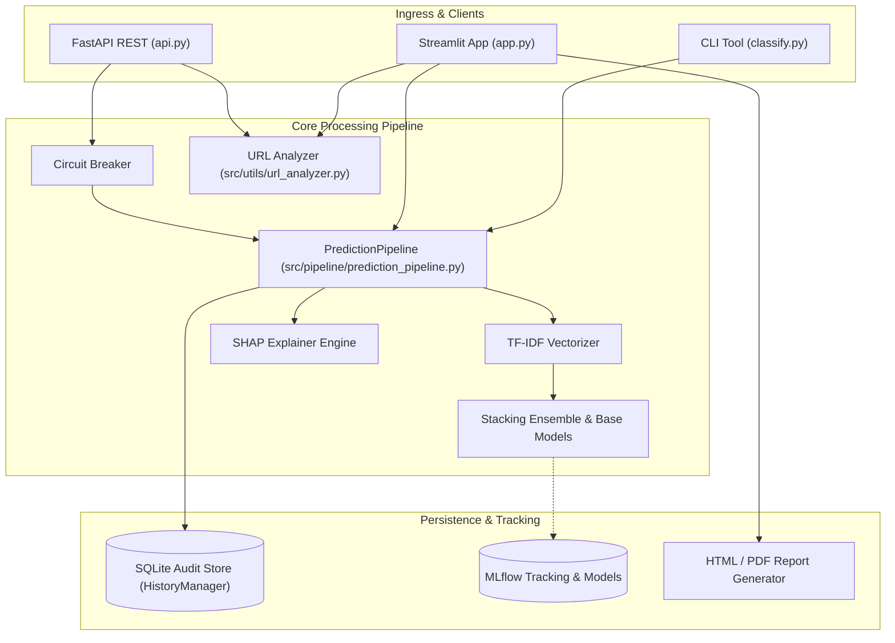

# Smart Spam Detector

[](https://github.com/themanoj-025/Smart-Spam-Detector/actions)
[](https://www.python.org/)
[](https://fastapi.tiangolo.com)
[](https://streamlit.io)
[](tests/)
[](LICENSE)

> A production-grade email classification platform combining 6 machine learning models, a stacking ensemble, SHAP explainability, embedded phishing URL heuristics, FastAPI REST endpoints, and a 4-tab Streamlit monitoring dashboard.

---

## Quick Facts

| Dimension | Details |
| --- | --- |
| **Architectural Pattern** | Modular ML Pipeline (Ingestion -> TF-IDF -> Stacking -> Serving) |
| **Model Portfolio** | Logistic Regression, Random Forest, XGBoost, SGD, Support Vector Classifier, Stacking Classifier |
| **Explainability Engine** | TreeSHAP and KernelSHAP per-word feature attribution with safe degradation |
| **Heuristic Security** | Phishing URL analyzer detecting IP hosts, deceptive redirects, and high-risk TLDs |
| **Application Surfaces** | FastAPI REST API (`api.py`), Streamlit Web UI (`app.py`), CLI Triage (`classify.py`) |
| **Reliability** | SlowAPI rate limiting, Circuit Breaker fallback pattern, SQLite history persistence |
| **Test Suite** | 164 collected pytest tests across unit, integration, and API suites |

---

## Table of Contents

- [Overview](#overview)
- [Key Features](#key-features)
- [System Architecture](#system-architecture)
- [Machine Learning and Explainability](#machine-learning-and-explainability)
- [Repository Structure](#repository-structure)
- [Quick Start](#quick-start)
- [API Reference](#api-reference)
- [Configuration](#configuration)
- [Verification and Testing](#verification-and-testing)
- [Roadmap](#roadmap)
- [Contributing](#contributing)
- [License](#license)

---

## Overview

Email spam and phishing vectors remain primary vectors for digital compromise and operational noise. **Smart Spam Detector** delivers a production-grade machine learning and heuristic inspection pipeline that categorizes messages into Spam or Ham with calibrated confidence, identifies suspicious hyperlinks, and surfaces word-level SHAP attributions so end users understand *why* a classification was rendered.

The repository accommodates both interactive analyst workflows and automated backend ingestion through three synchronized entry points: a 4-tab Streamlit dashboard, a high-throughput FastAPI REST server with rate limiting and Prometheus instrumentation, and a rapid CLI classifier for automated mail hooks.

---

## Key Features

- **6 ML Classifiers + Stacking Ensemble**: Trains and benchmarks Logistic Regression, Random Forest, XGBoost, Stochastic Gradient Descent, and SVC, alongside an Optuna-tuned Stacking Classifier.
- **SHAP Feature Attribution**: Generates word-level importance weights using Tree and Kernel SHAP, highlighting spam-indicating tokens in red and ham-indicating tokens in green.
- **Embedded Phishing URL Analyzer**: Extracts and audits URLs within incoming email bodies, evaluating IPv4 hostnames, URL shorteners, dangerous TLDs, and misleading query parameters.
- **Multi-Format Batch Ingestion**: Supports bulk parsing across `.mbox` mailbox archives, `.csv` exports, and `.xlsx` spreadsheets with automated reporting.
- **Enterprise Web API**: FastAPI service providing token authentication, client IP and API key rate limiting via SlowAPI, structured health probes, and Prometheus metrics.
- **Operational Dashboard**: Interactive Streamlit application offering single-message scoring, bulk file triage, live model comparison charts, and historical audit queries.

---

## System Architecture



---

## Machine Learning and Explainability

### Pipeline Stages

1. **Ingestion & Validation**: Reads raw email data, normalizes text encodings, strips malformed characters, and validates schema integrity.
2. **Text Preprocessing & Feature Extraction**: Strips residual HTML entities using BeautifulSoup, extracts header signatures, and transforms corpora via TF-IDF vectorization with tuned n-gram ranges.
3. **Model Selection & Tuning**: Trains base estimators with cross-validation and hyperparameter optimization driven by Optuna.
4. **Stacking Ensemble**: Combines out-of-fold probability predictions from diverse model families using a logistic regression meta-learner to maximize generalization accuracy.
5. **Explainability**: Applies SHAP to estimate local Shapley values for vocabulary terms, translating complex matrix operations into human-readable word attribution heatmaps.

---

## Repository Structure

```text
Smart-Spam-Detector/
├── src/
│   ├── components/            # Pipeline building blocks
│   │   ├── circuit_breaker.py # Fault-tolerant wrapper for inference calls
│   │   ├── data_ingestion.py  # Dataset loading and partitioning
│   │   ├── data_transformation.py # Preprocessing and TF-IDF vectorization
│   │   └── model_training.py  # Model fitting, evaluation, and stacking
│   ├── config/                # Centralized application settings
│   │   └── config.py          # Paths, thresholds, and hyperparameters
│   ├── pipeline/              # High-level pipeline orchestrators
│   │   ├── prediction_pipeline.py # Inference and SHAP calculation
│   │   └── training_pipeline.py   # End-to-end retraining sequence
│   ├── ui/                    # Streamlit interface components
│   │   ├── helpers.py         # Formatting, risk labels, and color scales
│   │   ├── model_loader.py    # Lazy artifact caching
│   │   ├── sidebar.py         # Navigation and status widgets
│   │   ├── tab_batch.py       # Batch upload and processing tab
│   │   ├── tab_history.py     # SQLite history explorer tab
│   │   ├── tab_models.py      # Benchmark comparison tab
│   │   └── tab_single.py      # Real-time text analysis tab
│   └── utils/                 # Utilities and helpers
│       ├── email_utils.py     # RFC-compliant email parsing
│       ├── history_manager.py # SQLite database CRUD operations
│       ├── logger.py          # Structured logging configuration
│       ├── mlflow_tracker.py  # Experiment metrics tracking
│       ├── report_generator.py# HTML and SVG report builder
│       └── url_analyzer.py    # Phishing URL heuristic scanner
├── tests/                     # 164 collected unit, integration, and API tests
├── api.py                     # FastAPI production server
├── app.py                     # Streamlit entry point
├── classify.py                # Command-line triage utility
├── pyproject.toml             # Ruff, Black, and pytest configurations
├── requirements.txt           # Production dependencies
└── Dockerfile                 # Containerized deployment blueprint
```

---

## Quick Start

### Prerequisites

- Python 3.11+
- Git

### Installation

```bash
# Clone repository
git clone https://github.com/themanoj-025/Smart-Spam-Detector.git
cd Smart-Spam-Detector

# Create virtual environment
python -m venv .venv

# Activate environment
# On Linux/macOS:
source .venv/bin/activate
# On Windows:
.venv\Scripts\Activate.ps1

# Install project dependencies
pip install -r requirements.txt
```

### Running the Interfaces

```bash
# 1. Run the Streamlit web dashboard (available at http://localhost:8501)
streamlit run app.py

# 2. Run the FastAPI REST server (available at http://localhost:8000)
uvicorn api:app --host 0.0.0.0 --port 8000 --reload

# 3. Classify an email directly from the command line
python classify.py "URGENT: Your account has been suspended. Click here to verify credentials."
```

---

## API Reference

### Core Endpoints

| Method | Endpoint | Description | Rate Limit |
| --- | --- | --- | --- |
| `GET` | `/` | API service metadata and version | 60/min |
| `GET` | `/health` | Liveness and model artifact readiness probe | None |
| `POST` | `/predict` | Predict single email category with confidence | 30/min |
| `POST` | `/predict/batch` | Bulk prediction across an array of messages | 10/min |
| `POST` | `/urls/analyze` | Standalone heuristic audit of extracted URLs | 30/min |
| `GET` | `/metrics` | Prometheus runtime metrics | None |

### Sample Request: Single Prediction

```bash
curl -X POST "http://localhost:8000/predict" \
  -H "Content-Type: application/json" \
  -d '{
    "text": "Exclusive offer! Claim your free gift voucher now by clicking the link.",
    "explain": true
  }'
```

### Sample Response

```json
{
  "prediction": "Spam",
  "confidence": 98.4,
  "risk_level": "High",
  "explanation": {
    "status": "available",
    "top_contributing_words": [
      {"word": "voucher", "score": 0.42},
      {"word": "free", "score": 0.38},
      {"word": "claim", "score": 0.25}
    ]
  },
  "url_analysis": {
    "total_urls": 0,
    "suspicious_count": 0
  }
}
```

---

## Configuration

Settings are configured via environment variables or a local `.env` file (copied from `.env.example`).

| Variable | Description | Default | Required |
| --- | --- | --- | --- |
| `SPAM_API_KEY` | Optional bearer token for restricted API operations | *None* | No |
| `MLFLOW_TRACKING_URI` | URI for experiment tracking and model storage | `sqlite:///mlflow.db` | No |
| `SPAM_DETECTOR_PORT` | Port for the FastAPI server | `8000` | No |
| `SPAM_DETECTOR_HOST` | Host binding for the API service | `0.0.0.0` | No |
| `LOG_LEVEL` | Minimum logging verbosity (`DEBUG`, `INFO`, `WARNING`) | `INFO` | No |

---

## Verification and Testing

The repository maintains an automated test suite executed with pytest.

```bash
# Execute test suite
pytest tests/ -v

# Run with coverage report
pytest tests/ --cov=src --cov-report=term-missing
```

- **Collected Tests**: 164 tests
- **Test Categories**: Input boundary validation, TF-IDF feature alignment, SHAP explanation edge cases, SQLite history manager concurrency, URL heuristic analyzers, and FastAPI route responses.

---

## Roadmap

- [x] 6-model training pipeline and Optuna-tuned Stacking Classifier
- [x] Word-level SHAP explanation generation and visualization
- [x] Streamlit multi-tab user interface with file batch processing
- [x] Production FastAPI service with rate limiting and Prometheus metrics
- [x] Heuristic phishing URL threat analyzer
- [ ] Direct IMAP / POP3 live mailbox synchronization agent
- [ ] Multi-lingual spam classification leveraging lightweight transformers
- [ ] Active learning feedback loop from analyst corrections

---

## Contributing

Contributions and enhancements are welcomed. Please review [CONTRIBUTING.md](CONTRIBUTING.md) and adhere to the project security policies outlined in [SECURITY.md](SECURITY.md).

---

## License

This project is licensed under the MIT License — see the [LICENSE](LICENSE) file for complete details.
